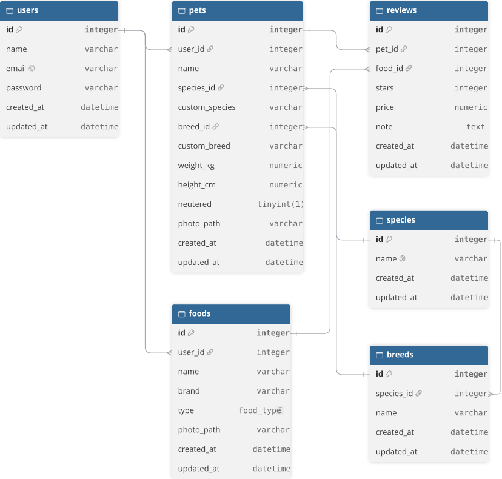
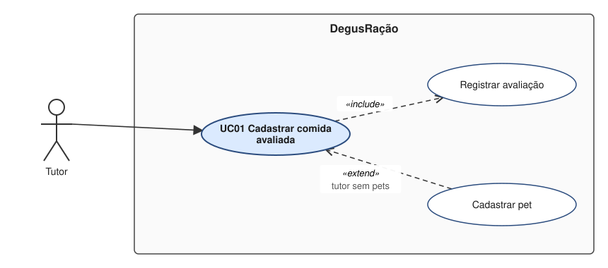
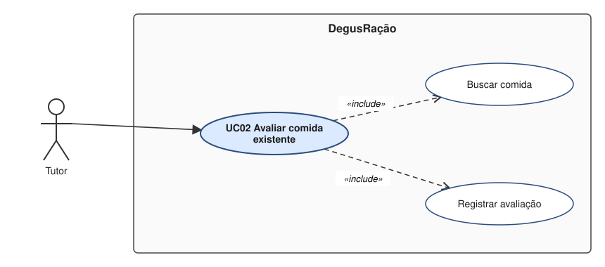
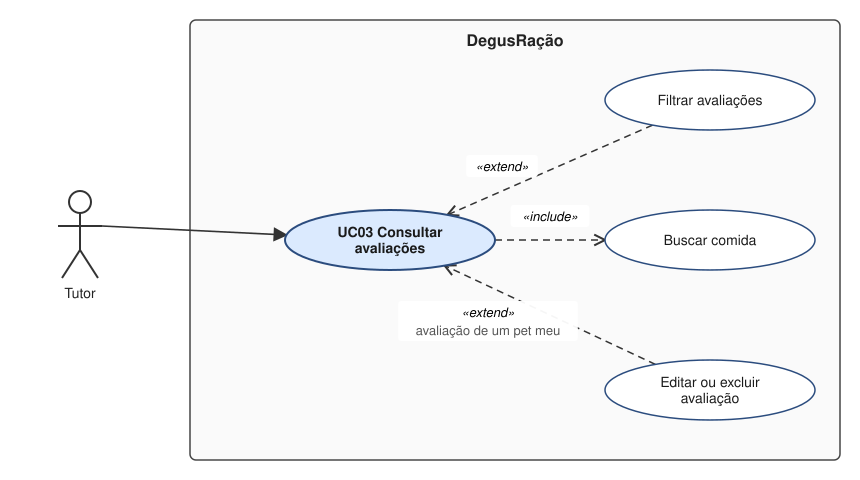
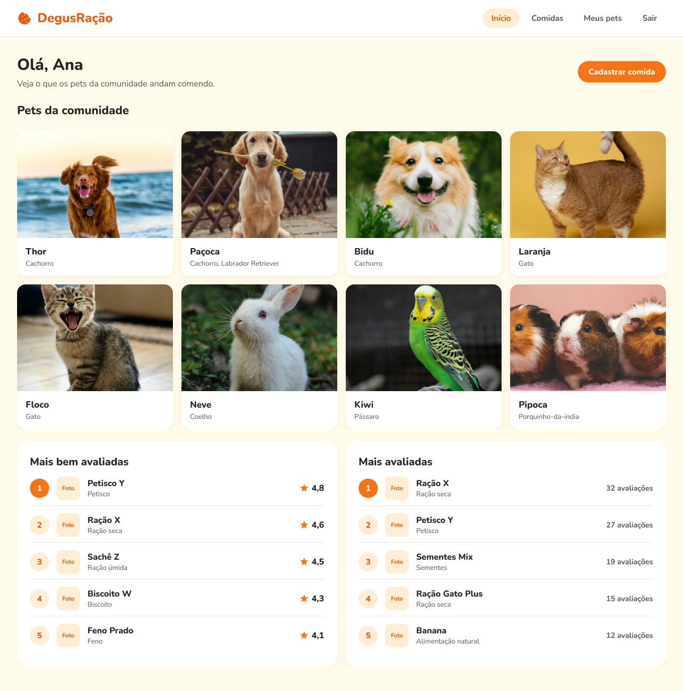
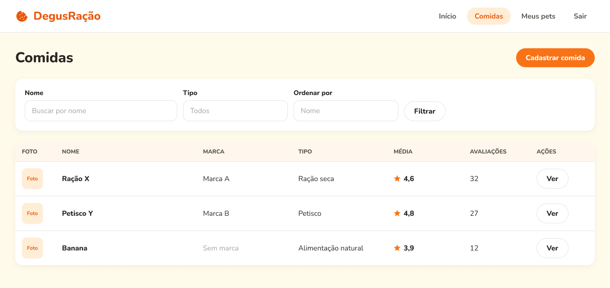
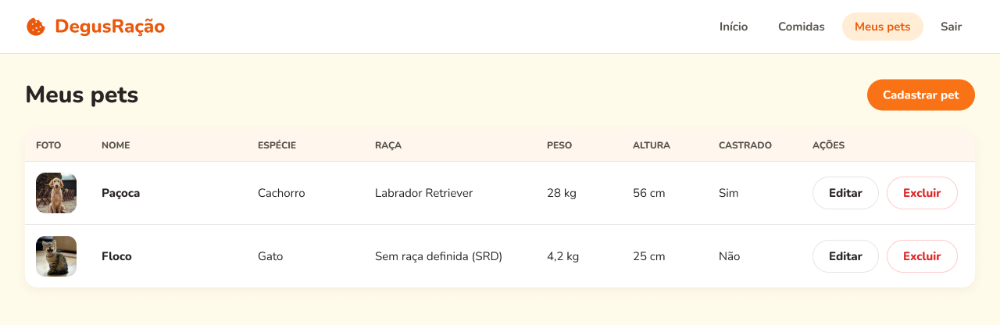
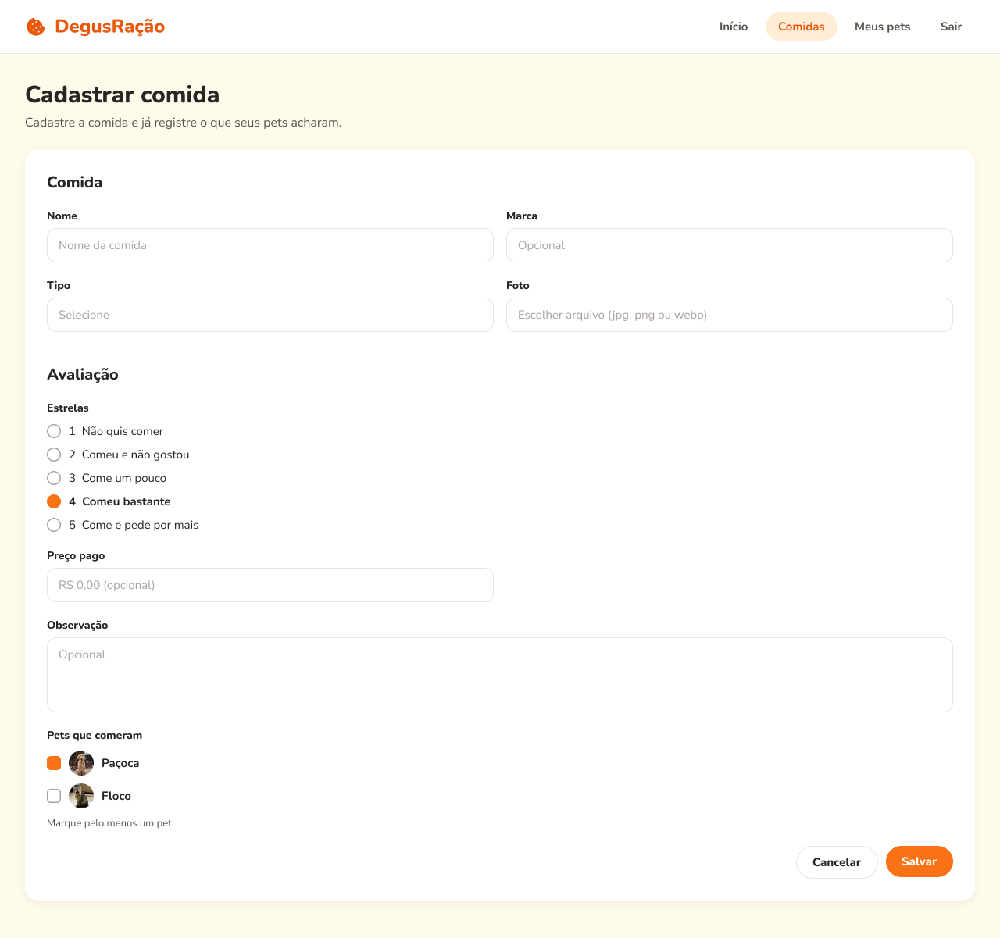
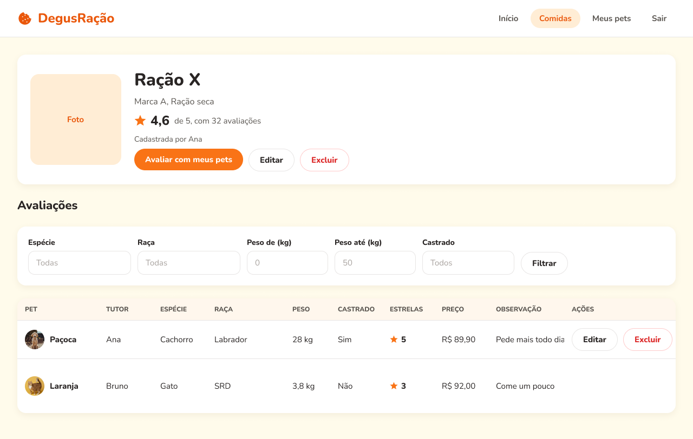

# DegusRação

> Site de avaliações de comidas para pets. Qualquer tipo de comida ou petisco. O tutor registra o que o seu pet achou da comida e esta avaliação fica visível para outros tutores.

Projeto da disciplina Desenvolvimento de Aplicações Backend com Framework (UTFPR).

## Motivação

Ter um leque de opções de fato catalogadas e testadas para alimentação de pets.

## Objetivos

Tornar a escolha de comidas e petiscos para pets mais concisa. Permitindo basear as escolhas de alimentação com base na raça e avaliação que outras pessoas fizeram.

## Funcionalidades planejadas

- Cadastro, login e logout do tutor (usuário).
- Cadastro dos pets, com foto opcional (para implementar o módulo de arquivo da disciplina).
- CRUD e filtros: comidas, avaliações, pets.
- Dashboard com comidas melhor avaliadas.
- Docker, tanto por praticidade para rodar o ambiente em minha máquina, quanto para testes em outras máquinas e requisito da disciplina;
- CI/CG;
- Não pensado por enquanto integração com sistema de e-mails;

## Documentação

- [Especificação](docs/specification.md): glossário ubíquo, requisitos priorizados (MoSCoW) e cenários Given/When/Then.
- [Modelo do banco de dados](docs/database.dbml): código DBML do diagrama, para abrir no [dbdiagram.io](https://dbdiagram.io).
- [Casos de uso](docs/use-cases): código PlantUML dos casos de uso principais.
- [Wireframes](docs/wireframes): telas do protótipo no Figma.

## Diagrama do banco de dados

> Database gerado a partir de [dbdiagram.io](https://dbdiagram.io) com arquivo [/docs/database.dbml](/docs/database.dbml).

## Casos de uso

> O código dos diagramas está em [docs/use-cases](docs/use-cases/).

## Wireframes

> Wireframes com Figma

